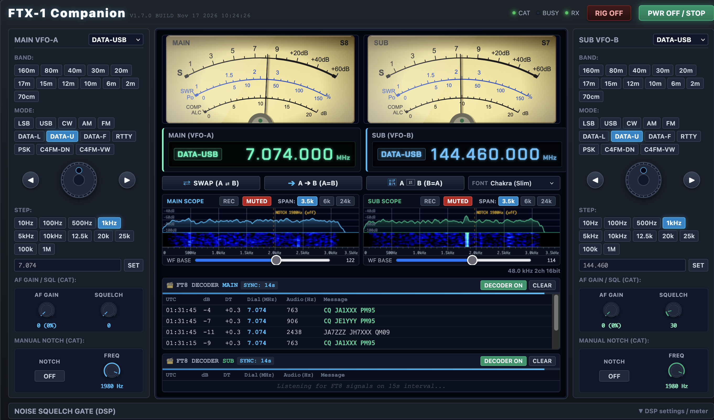
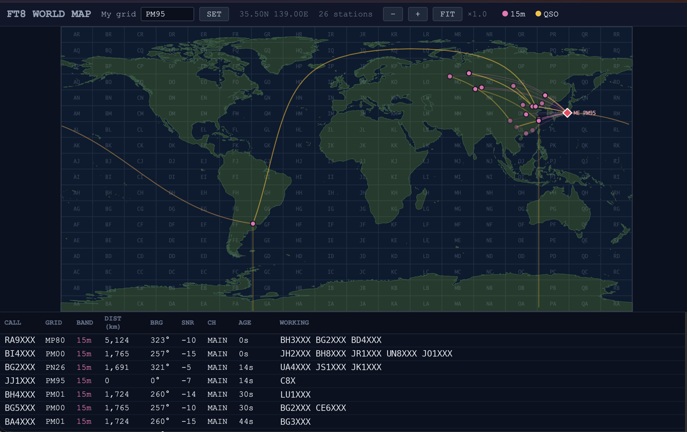

| Supported Targets | ESP32-S3 |
| ----------------- | -------- |

# FTX-1 Network Companion

*Built for hams by a lazy ham*

**English** | [日本語](README.ja.md)



Propagation never sits still, and sometimes you just can't stop wondering what the bands are doing right now. Is 20 m open? Is that station still coming through?
You'd like to know, but getting up and walking to the shack, let alone settling in front of the radio, feels like too much effort.

This is built for exactly those moments. The rig stays where it is. From anywhere in the house, a PC or Mac with a browser is all you need to change frequency and mode, listen to the receive audio, read the S-meter, and even watch FT8 decodes scroll by.
Do it from the sofa, or next to your after-dinner coffee. For the gloriously lazy ham, it is the right tool.

The firmware starts in receive-only mode. Remote push-to-talk is available on the FTX-1 and FTDX10 after it is enabled in the serial menu. See [Transmit](#transmit).

## Overview

Firmware for the ESP32-S3, a small Wi-Fi-capable microcontroller board. You connect it to the Yaesu FTX-1 over USB, and it relays the rig's receive audio and status over Wi-Fi to the PC / Mac at hand.

- **Audio**: the ESP32-S3 takes the receive audio from the FTX-1's USB audio and streams it to your browser over Wi-Fi. The FTX-1 appears to a computer like a "USB microphone", using the standard USB audio class (UAC 1.0).
- **Control and status**: through the FTX-1's USB serial port, the browser changes frequency and mode and reads the S-meter and other values. This way of controlling and monitoring a radio from a computer is called **CAT** (Computer Aided Transceiver).
- **FT8**: the received audio is decoded inside the browser.

All the PC / Mac needs is a browser on the same LAN. No dedicated software is required.

```
FTX-1
 ├─ USB Audio (UAC 1.0) ──────────> ESP32-S3 ──Wi-Fi / HTTPS──> browser / ffplay / VLC
 └─ USB Serial (CP210x / CAT) ────>            ├─ Audio streaming (PCM / WAV)
                                               ├─ Real-time FT8 decoder in the browser
                                               ├─ CAT control (frequency, mode, squelch, ...)
                                               └─ OTA firmware update
```

> "OTA" in the diagram stands for Over-The-Air: updating the firmware over the network, without a cable (see "OTA update").

## Supported radios (this fork)

The firmware recognises the radio from its answer to the CAT command `ID;` and loads a profile for it.

| | Yaesu FTX-1 | Yaesu FTDX10 |
| --- | --- | --- |
| `ID;` answer | `ID0840;` | `ID0761;` |
| CAT rates tried | 115200, 38400, 4800, 9600, 19200 bps (whatever **CAT-1 RATE** is set to) | the same list; the FTDX10 offers up to 38400 (**CAT RATE**) |
| Receivers | MAIN + SUB (two S-meters, AF gain, squelch, notch and FT8 decoders for each) | one receiver; "SUB" is only VFO-B (frequency and mode) |
| Frequency range accepted | 30 kHz – 470 MHz | 30 kHz – 75 MHz |
| Squelch range | 0 – 255 | 0 – 100 |
| BUSY / TX state | `RI0;` | `BY;` and the read form `TX;` |
| S-meter | `RM0;` (MAIN and SUB) | `RM1;` |
| Menu item written in DATA-USB | `EX010411` USB OUT LEVEL = 100 | `EX010413` DATA OUT LEVEL = 100 |
| USB audio (measured) | UAC 1.0, 48 kHz / 44.1 kHz, 2 ch, 16 bit; L = MAIN, R = SUB | UAC 1.0, 18 formats from 8 to 48 kHz, 1 or 2 ch, 8 or 16 bit; 48 kHz 2 ch 16 bit is used |
| USB descriptor | fits the default 256-byte control buffer | larger: needs `CONFIG_USB_HOST_CONTROL_TRANSFER_MAX_SIZE=2048` (set in `sdkconfig.defaults`) |

Both radios connect the same way: one USB cable carries the two CP210x serial ports (the CAT one is found automatically) and the USB audio codec. The browser page adapts to the radio it reports: on the FTDX10 the SUB receiver controls, the SUB scope and the SUB FT8 decoder are hidden, and the 2 m / 70 cm band buttons and the C4FM modes are not shown.

A radio that answers `ID;` with a model the firmware does not know gets a read-only profile: its frequency and mode are shown, but nothing is ever sent to it except read commands.

> The menu numbers differ between the two radios. For example `EX010411` is USB OUT LEVEL on the FTX-1 but HCUT FREQ on the FTDX10, which is why every menu write belongs to a radio profile.

## Hardware requirements

| Item | Requirement |
| --- | --- |
| Board | ESP32-S3 (tested with the **ESP32-S3-DevKitC-1**; see "Recommended board" below) |
| Flash | **16 MB** for the partition table in [`partitions.csv`](partitions.csv) (two 4 MB OTA slots and a data partition). For a smaller flash, see [Changing the flash size](#changing-the-flash-size) |
| PSRAM | Not required. Used when present (for example an **ESP32-S3-N16R8** board with 8 MB octal PSRAM): large buffers (TLS, Wi-Fi) then go to PSRAM and leave internal RAM free |
| Network | A LAN with Wi-Fi (2.4 GHz) |

> If your module has a flash size other than 16 MB, see [Changing the flash size](#changing-the-flash-size) after setting up the development environment.

### Recommended board

This project targets the **ESP32-S3-DevKitC-1**, a development board from Espressif, the maker of the ESP32. It is an entry-level, inexpensive board and is easy to get from online shops such as Amazon. You can start using it with just a USB cable to your PC.

The author uses a compatible board from Freenove (see "How to connect it" for details). Compatible boards with the same layout (two USB ports, a USB-to-UART bridge, an ESP32-S3-WROOM-1 module) should work the same way.

A bare board can short against metal or wiring around the radio, or collect dust. Putting it in a case is recommended if needed. When choosing one, keep the following in mind.

- Both USB ports must stay usable (see "How to connect it" below for what each one is for).
- You must be able to reach the BOOT / RST buttons on the board.
- On many boards the Wi-Fi antenna is on the board itself, so a resin case is the safer choice over a metal one.

### How to connect it

The ESP32-S3-DevKitC-1 has two USB ports. Use them as follows.

| Port | Connect to | When |
| --- | --- | --- |
| **USB-OTG** | **FTX-1** (audio and CAT) | In normal use |
| **USB-UART** | **PC** | Only for the initial setup and flashing |

The label for each port is printed on the board (the silkscreen), next to the port. On the Freenove board the two ports are labeled, and other boards are likely to be labeled in the same way. Check the label before you connect.

- The port that goes to the FTX-1 is USB-OTG. In normal use you do not need to connect a PC to the USB-UART port.
- Connect the USB-UART port to a PC only to use the serial menu (Wi-Fi settings and so on) and to flash the firmware (see "First-time setup and flashing").
- In normal use, the USB-OTG port goes to the FTX-1, so connect a power source to the **USB-UART port**. It does not need to be anything special: an ordinary USB charger or a USB battery pack is enough (the power consumption is small).
- **Use USB cables that carry data.** A charge-only cable does not work for either port.
- **The connector shapes depend on the board.** The official ESP32-S3-DevKitC-1 has two **Micro-USB** ports (see Espressif's [user guide](https://docs.espressif.com/projects/esp-dev-kits/en/latest/esp32s3/esp32-s3-devkitc-1/user_guide_v1.1.html)), while the FTX-1 has a **USB Type-C** port. Choose the cable or adapter to match the connector on your board and on the FTX-1.
- **The author's setup (one example):** a compatible board from Freenove ([FNK0099](https://store.freenove.com/products/fnk0099), with two **USB Type-C** ports) connected to the FTX-1 with a good-quality data cable that has **USB Type-C on both ends** (not a charge-only cable). Because both sides are Type-C, one such cable is enough.
- The ESP32-S3 acts as the USB host (the parent side), and the FTX-1 is the device it reads from.

> **Do not expose it to the Internet.** The firmware takes a reasonable level of security into account, but it is not designed to have a port open to the Internet (for example by port forwarding on your router). Use it only on a trusted LAN at home. See "Security notes" for details.

## How to approach this project

### Who this is for

People who can shrug and say, "Well, that's about what you'd expect." It is not for anyone who needs polish or thorough support.
If it works, lucky you. If it doesn't, have a look inside and fix it. If you can take it in that spirit, we will get along fine.

### Forks are very welcome

It only contains the features I wanted in order to be lazier. Whatever is missing, please feel free to fork it and build more features for the lazy ham.
I would love to see more improvements out there that make life easier.
For technical evaluations and future improvement ideas (such as on-device FT8 decoding directly on the ESP32-S3), see [`docs/future_ideas.md`](docs/future_ideas.md).

### About issues

Issue reports are welcome. Handling them is **best effort**, though: replies, fixes and new features are not promised.
Please be patient, or, even better, fork it and share what you fixed.

## Disclaimer

This project implements only the features that I, a lazy ham, found necessary to make my own life easier. It is not a general-purpose product and does not try to cover every use case.

- The software is provided "AS IS", without warranty of any kind. There is no guarantee that it works on any particular radio, environment or purpose, and no promise of maintenance, bug fixes or support.
- The author accepts no liability whatsoever for any damage arising from the use of, or the inability to use, this software, including damage to radios or peripheral equipment, loss of data, network or security problems, and any other direct or indirect damage.
- Use it entirely at your own risk. Flashing the firmware, OTA updates and connecting equipment are done on your own judgement and responsibility.
- Complying with the laws and regulations that apply to operating a radio station and to receiving radio signals is your own responsibility.
- This is a personal project. It is not affiliated with, or endorsed by, Yaesu Musen Co., Ltd. or any other product or company mentioned here.

## License

The copyright of this project belongs to the author. The code is released under the [PolyForm Noncommercial License 1.0.0](LICENSE) (the source files carry `SPDX-License-Identifier: PolyForm-Noncommercial-1.0.0`).

- **Allowed**: you may use, copy, modify and redistribute it freely for any noncommercial purpose, such as personal use, hobby projects and amateur radio.
- **Not allowed**: commercial use. Please contact the author if you would like to use it commercially.
- **Please keep the origin**: when you redistribute it or publish a modified version, keep the `LICENSE` file (with its `Required Notice:` line) and say where it came from.

Because commercial use is excluded, this license is not an "open source" license in the sense of the Open Source Initiative's definition. It is "source-available".

Part of this project follows the structure of the example code of Espressif's `usb_host_uac` component (Apache License 2.0, the USB Host task in [`main/usb_audio.c`](main/usb_audio.c)), and that part remains under the Apache License 2.0. Details are in [`NOTICE`](NOTICE).
Third-party components fetched at build time (the ESP-IDF and the components under `managed_components`) keep their own licenses. For the projects the FT8 decoder refers to, see "About the FT8 decoder".

---

## Development environment setup

### Option A: Dev Container (recommended)

A **Dev Container** puts the whole development environment in a Docker container.
ESP-IDF has many installation steps and is awkward to manage in Python, so a Dev Container
sets up "ESP-IDF v6.1 + openssl + the Espressif extension" automatically and gives you the same
build environment on macOS, Linux, and Windows.

**Requirements**:
- [Docker Desktop](https://www.docker.com/products/docker-desktop/)
- [VS Code](https://code.visualstudio.com/) (extension: [Dev Containers](https://marketplace.visualstudio.com/items?itemName=ms-vscode-remote.remote-containers))

```bash
# 1. Get the repository
git clone <URL of this repository>

# 2. Open the folder in VS Code and choose "Reopen in Container"
#    The first run downloads the Docker image (espressif/idf:v6.1), which takes a few minutes
#    ESP-IDF v6.1, openssl, and the Espressif extension are set up automatically
```

Flashing over USB serial needs the `--privileged` flag (already set in `devcontainer.json`).

> **Note**: With Docker Desktop on macOS / Windows, the USB serial port may not be visible from inside the container. In that case, only build inside the container and flash from the PC side (outside the container). The `build/` folder created by the build is also visible from the PC side as is. For the flashing steps, see "Flashing from outside the container" in "First-time setup and flashing".

### Option B: Local (macOS / Linux)

**Requirements**:

| Tool | Version | Where to get it |
| --- | --- | --- |
| ESP-IDF | **v6.1** | [Installation guide](https://docs.espressif.com/projects/esp-idf/en/v6.1/esp32s3/get-started/index.html) |
| openssl | any (the system one is fine) | macOS: `brew install openssl` / Ubuntu: `apt install openssl` |
| Python | 3.10 or later (ESP-IDF checks this at startup and stops if it is too old) | macOS: `brew install python` / Ubuntu: `apt install python3 python3-venv` / [python.org](https://www.python.org/downloads/) |
| cmake | 3.22 or later (bundled with ESP-IDF) | Same as above |

ESP-IDF components (`espressif/usb_host_uac`, `espressif/usb_host_cp210x_vcp`, `espressif/mdns`, and others) are
downloaded from the [ESP Component Registry](https://components.espressif.com) during `idf.py build`.

```bash
# 1. Install ESP-IDF v6.1 (first time only)
mkdir -p ~/esp && cd ~/esp
git clone -b v6.1 --recursive https://github.com/espressif/esp-idf.git
cd esp-idf && ./install.sh esp32s3

# 2. Get the repository
git clone <URL of this repository>
cd ftx1_companion

# 3. Activate the ESP-IDF environment
source ~/esp/esp-idf/export.sh        # bash / zsh

# 4. Build (the first build downloads the dependent components)
idf.py set-target esp32s3
idf.py build

# 5. Flash the ESP32-S3 (PORT is /dev/cu.usbserial-* or similar on macOS)
idf.py -p PORT flash monitor
```

> **Note**: Running `idf.py set-target` or `idf.py fullclean` regenerates the TLS certificate (`build/certs/`).
> Accept the certificate in the browser again afterwards.

## Changing the flash size

The default is 16 MB (`CONFIG_ESPTOOLPY_FLASHSIZE_16MB=y` in [`sdkconfig.defaults`](sdkconfig.defaults)).
If your module is different, change the following.

1. In [`sdkconfig.defaults`](sdkconfig.defaults), change `CONFIG_ESPTOOLPY_FLASHSIZE_16MB=y` to match your module
   (for example `CONFIG_ESPTOOLPY_FLASHSIZE_8MB=y` for 8 MB).

2. Rebuild:

   **Option A (Dev Container)**: run in the VS Code terminal (inside the container)
   ```bash
   idf.py fullclean && idf.py build
   ```

   **Option B (local)**: run in a terminal with the ESP-IDF environment activated
   ```bash
   source ~/esp/esp-idf/export.sh
   idf.py fullclean && idf.py build
   ```

> The partition table is [`partitions.csv`](partitions.csv): two 4 MB app slots and an 8 MB data partition for a 16 MB flash. For an 8 MB flash, make both app slots 0x300000 (3 MB) and shrink or drop `storage`; for 4 MB, go back to two 0x1A9000 slots and drop `storage` (the app must stay below that size).

## First-time setup and flashing

### 1. Build and flash

Credentials (Wi-Fi password and OTA password) do not have to be built in. You can build and flash as is.

Connect **only the USB-UART port** of the ESP32-S3 to the PC, then run the following. Replace `PORT` with the name of the ESP32-S3's serial port as seen from the PC.

```bash
idf.py build
idf.py -p PORT flash monitor
```

| OS | Example `PORT` | How to find it |
| --- | --- | --- |
| macOS | `/dev/cu.usbserial-0001` | `ls /dev/cu.usb*` |
| Linux | `/dev/ttyUSB0` | `ls /dev/ttyUSB*` |
| Windows | `COM3` | "Ports (COM & LPT)" in Device Manager |

- Unplug and replug the cable: the name that disappears and reappears is the ESP32-S3's port.
- If no port appears, you may need the driver for the board's USB-UART chip (CP210x).
- To leave `idf.py monitor`, press `Ctrl` + `]`.

#### Flashing on Windows with a double click

[`tools/scrie_firmware.bat`](tools/scrie_firmware.bat) (Romanian prompts) installs esptool if needed, lists the COM ports, and either updates the app while **keeping** the Wi-Fi and passwords (`ota_data_initial.bin` at 0xf000 and the app at 0x20000) or writes the whole merged image (which **erases** the settings, for a new board). Put it in the folder with the `.bin` files from `build/`, with the merged image renamed to `ftx1_companion-merged.bin` and the app to `ftx1_companion_ota.bin`.

> Writing the merged image at 0x0 also overwrites the NVS partition (0x9000), so the settings are lost. To update a configured board, write only the app, or use OTA.

#### Flashing from outside the container

If the USB serial port is not visible from inside the Dev Container, build inside the container and flash only from the PC side.

```bash
# Inside the container (build, and create the file used for flashing)
idf.py build
idf.py merge-bin     # creates build/merged-binary.bin

# On the PC side (outside the container). Install esptool once, then flash
python3 -m pip install esptool
python3 -m esptool --chip esp32s3 -p PORT write-flash 0x0 build/merged-binary.bin
```

After flashing, open the ESP32-S3's port with any serial monitor you like, such as Tera Term (115200 bps).

### 2. Interactive setup over the USB UART serial console (stored in NVS)

Settings such as the Wi-Fi network and passwords are stored in the ESP32-S3's **NVS** (Non-Volatile Storage: an area inside the microcontroller that keeps its contents when the power is off).
After flashing, or at boot, connect a PC to the USB-UART port and open a serial monitor for the ESP32-S3 (`idf.py monitor`, Tera Term, and so on).

- **First boot (Wi-Fi not configured)**: the configuration menu opens automatically.
- **Already configured**: a 3-second countdown is shown at boot. Press `c`, `m`, or `Enter` to enter the configuration menu. You may also press the BOOT button, but **only after the board has started**. If you hold it down during a reset or power-up, the board starts in flashing mode instead of running the firmware, and the menu does not appear.

```text
**************************************************
*       FTX-1 Companion Configuration Menu       *
**************************************************

==================================================
           CURRENT RUNTIME CONFIGURATION
==================================================
 1) Wi-Fi SSID       : (not set)
 2) Wi-Fi Password   : (empty / disabled)
 3) OTA User ID      : ota
 4) OTA Password     : (empty / disabled)
 9) Web User ID      : admin
 0) Web Password     : (empty / disabled)
 h) Host name        : ftx-1c.local
==================================================
Options:
  1: Set Wi-Fi SSID
  2: Set Wi-Fi Password
  3: Set OTA User ID
  4: Set OTA Password
  9: Set Web User ID
  0: Set Web Password
  h: Set Host name (mDNS / DHCP)
  5: Show passwords in plain text
  6: Save to NVS and Restart device
  7: Exit and continue boot without saving
  8: Erase NVS configuration (Reset to defaults)
--------------------------------------------------
Enter selection (0-9, h):
```

Set at least these three.

1. Enter `1`, then the Wi-Fi SSID.
2. Enter `2`, then the Wi-Fi password (shown masked).
3. Enter `0`, then the **web password** (at least 12 characters; this is the password you use to log in from the browser).

Then set the following as needed.

- `9`: the web user ID (default `admin`)
- `3` / `4`: the OTA update user ID and password (the password must be at least 12 characters)
- `h`: the host name (the default is `ftx-1c`; see "Host name (mDNS)" below)

Finally, enter `6` to run "Save to NVS and Restart device". **Nothing takes effect until you save with `6`.**

> **The web password is required.** Without it, the browser shows `Access is disabled (no password configured)` (HTTP 403) and nothing opens. It never opens without authentication.
>
> The SSID and passwords accept only half-width alphanumerics and symbols (ASCII). Non-ASCII characters, such as Japanese, cannot be entered.

> **Benefit when publishing on Git**: all passwords are stored in the microcontroller's NVS (non-volatile memory). No private settings remain in the Git repository or in build artifacts, so you can publish the source or share binaries safely.

### 3. Check it in the browser

1. After the restart the device connects to Wi-Fi, and the serial monitor log shows `Got IP: x.x.x.x` and `Open https://ftx-1c.local/`.
2. Turn on the FTX-1 and connect the ESP32-S3's **USB-OTG port** to a USB port on the FTX-1 (see "How to connect it").
3. In a browser on a PC / Mac on the same LAN, open `https://ftx-1c.local/` (or `https://<the IP shown in the log>/`). Use `https://`, not `http://`.
4. Because the certificate is self-signed, **a warning appears**. This is your own device on your own LAN, so check the details and continue (accept) (see "Self-signed certificate").
5. You are asked for a user ID and password. The ID is `admin` (or the ID you set with `9`), and the password is the web password you set with `0`.
6. Press **POWER / PLAY** to start playing the received audio. The button changes to `PWR OFF / STOP`; press the same button again to stop.

If it does not work, see "Troubleshooting".

## Host name (mDNS)

While no host name is stored in NVS (first boot, or after erasing the configuration with `8`), the host name is `ftx-1c`.
It is reachable at `https://ftx-1c.local/` through **mDNS** (Multicast DNS: a way to reach a device on the same LAN as "name.local" without a DNS server; using [`espressif/mdns`](https://components.espressif.com/components/espressif/mdns)).
The same name is also sent as the DHCP host name (the name shown in your router's client list).

### Changing the host name (serial menu)

1. Open the menu in the serial monitor (automatic when Wi-Fi is not configured; otherwise press `c` / `m` / `Enter` within 3 seconds after boot).
2. Enter `h`, then the host name **without** `.local`. Press Enter alone to keep the current value.
3. Enter `6` (Save to NVS and Restart device). **The change takes effect only after saving and restarting.** Leaving with `7` discards it.

```text
Enter selection (0-9, h): h
Enter Host name without ".local" [Current: ftx-1c] (a-z, 0-9, '-'; DEFAULT to reset; Enter to keep): radio-shack
-> Host name set to: radio-shack.local
```

- Allowed: lowercase `a-z`, `0-9` and `-`; no `-` at the start or end; up to 63 characters. Names with uppercase letters, `_`, spaces or `.` are rejected ("Rejected" is printed) and the old value is kept.
- Enter `DEFAULT` to go back to `ftx-1c` (option `8`, "Erase NVS configuration", also resets it together with the other settings).
- If the stored value is invalid for any reason, it is replaced by `ftx-1c` at boot.
- The URL is also printed in the boot log as `Open https://<host name>.local/`.
- Update bookmarks and commands (`ffplay`, `curl`, and so on) to the new name. The old name no longer works.

### Notes

- **Certificate name**: the certificate SAN (`ftx-1c` / `ftx-1c.local`) is fixed at build time. With a different host name the browser shows a name-mismatch warning in addition to the self-signed one. You can still proceed after checking it; to avoid the warning, see "Using a certificate for another host name" under "Self-signed certificate".
- **Duplicate names**: if another device with the same name is on the LAN, mDNS may automatically rename this one, for example `ftx-1c-2.local`. When you use several units, give each a different host name.
- **Browser state**: a new host name is a different site for the browser, so you have to log in (Basic authentication) and accept the certificate again.
- macOS, iOS, Windows 10 and later, and recent Linux (avahi) resolve `.local` out of the box.
- Where it does not resolve, use the IP address shown in the log.

## Usage

### Endpoints

All of them require Basic authentication (see "Security notes" below).

| Path | Description |
| --- | --- |
| `/` | Browser player |
| `/status` | Stream state and diagnostics (JSON): firmware version (`version`), build time (`build`), audio format, uptime, heap (`heap_free` / `heap_min` / `heap_block`; these include PSRAM if it is enabled), internal-RAM-only heap (`int_free` / `int_min` / `int_block`), Wi-Fi `rssi`, and stream send statistics (`stream.slow_sends` / `stream.max_send_ms`, and others) |
| `POST /cat` | Controls the radio (frequency, mode, volume, and so on; JSON, `X-Requested-With: ftx1` required) |
| `POST /reboot` | Reboot the ESP32-S3 (JSON, `X-Requested-With: ftx1` required) |
| `/stream.pcm` | Raw PCM (little endian). The format is reported in the `X-Sample-Rate` / `X-Channels` / `X-Bytes-Per-Sample` headers |
| `/stream.wav` | With a WAV header (indefinite length). For external players |
| `POST /ota` | Firmware update (Basic authentication; see "OTA update" below) |
| `http://…` (port 80) | Redirects every request to the same host over `https://` (so typing just the IP or `ftx-1c.local` works). Serves nothing else and asks for no login |

Example with an external player (48 kHz / 16 bit / mono):

```
ffplay -nodisp -tls_verify 0 https://ftx-1c.local/stream.wav
```

## The FTDX10's own scope from the ACC socket

With an FTDX10, the page can show the radio's own spectrum and waterfall (up to a 1 MHz span) instead of the audio
scope. The radio clocks its scope out of the ACC socket as SPI, 25 frames a second; this board reads it directly.
The frame layout is the one measured on an FTDX10 for the [Yaesu ACC Spectrum](https://github.com/mm5agm/Yaesu_ACC_Spectrum)
project (`docs/protocol.md`); the code here is written from that description.

**Wiring** (the same as that project's board): each signal through **470 ohm**, ground direct.

| ACC pin | Signal | GPIO |
|---|---|---|
| 2 | GND | GND |
| 3 | DATA1 | 14 (unused) |
| 4 | DATA2 | 11 |
| 5 | CLOCK | 10 |
| 6 | CS | 13 |
| 11 | CNT RX | 39 |
| 12 | CNT TX | 38 |

Link GPIO38 and GPIO39 (the free ends of the pin 11 and 12 resistors) with a wire: the radio's once-a-second
`alive` then comes back and the radio streams. **Never connect ACC pins 1, 7, 8 (13.8 V), 9 (PTT), 10 and 13.**
Plug and unplug only with the radio's power supply off. Read that project's `docs/fuse-risk.md` first.

- The pins are set up only after CAT has identified an **FTDX10**; with any other radio nothing is done with them.
- Each frame is checked (length, FTDX10 layout, both VFO copies, span and placement, and the VFO against CAT's
  frequency); `/status` → `acc` shows frames per second, accepted / rejected per reason.
- `GET /scope.bin` streams the rows (`?fps=1-25`). In the page, the MAIN scope has a **waterfall source** selector:
  **Auto** (the ACC scope when its data arrives, otherwise the audio scope), **Audio**, **ACC**. Click or tap on the
  ACC waterfall to tune MAIN there. The display scale follows the noise floor and the strongest signals.
- Span, placement (Center / Cursor / Fix) and LEVEL are set on the radio; keep LEVEL at about +20.

## Pseudo squelch (in the browser)

The USB audio of the Yaesu FTX-1 may ignore the radio's own squelch (noise comes out even with no signal).
So the player page ([`main/index.html`](main/index.html)) has a pseudo squelch that judges the audio and mutes it.
**It affects only playback in this page; `/stream.pcm` and `/stream.wav` are unchanged.**

### Detection modes

| Mode | Opens when | Use |
| --- | --- | --- |
| Variation (default) | The level swing (max − min) over the last 300 ms exceeds the "variation threshold" (default 8 dB) | AM |
| Level | The level exceeds the "threshold" (default -34 dBFS). "Invert" reverses it | FM / SSB |

- With no signal, AM noise settles at about -27 dBFS because of AGC, and the level can be about the same while a signal is received.
  The level cannot tell them apart, so AM is judged by the swing.
  In measurements, 99% of the 300 ms swings with no signal were 6.4 dB or less (max 7.2 dB), and 10 to 40 dB while receiving.
- After opening it holds for 0.4 s so word endings are not cut. Hysteresis is 3 dB (level mode) and the fade is 10 ms.
- Settings (on/off, mode, thresholds, which audio to judge) are stored in the browser's localStorage.

### L and R are judged separately

The FTX-1 USB audio is 48 kHz stereo: L is MAIN (VFO-A) and R is SUB (VFO-B). This does not change with the frequency band.
By default ("judge L and R separately") each channel has its own gate, so when only one side receives, the other stays closed.
Below the meter, the level, swing, and open/closed state of each channel are shown. If it misbehaves, adjust the thresholds using those numbers.

- Raise the variation threshold: when it opens by mistake with no signal (about 10 to 12 dB)
- Lower the variation threshold: when it does not open while receiving (about 6 dB)
- Choosing something like "judge on R, open and close both" makes one gate open and close both channels together.

### Limitations

- A continuous voice that stays at almost the same level for 300 ms or more can cause it to close (eased by the 0.4 s hold).
- It does not judge by the content of the audio, so noise with large swings (such as lightning) opens it.
- Reading the radio's BUSY or S-meter over CAT would be more accurate, but it needs USB serial (CDC) host support and is not implemented.

## About the FT8 decoder

The real-time FT8 decoder implemented in the browser ([`main/index.html`](main/index.html)) is based on the specifications and implementations of the following open-source projects.

| Project | What was referred to |
| --- | --- |
| **[ft8_lib](https://github.com/kgoba/ft8_lib)** by Karlis Goba (YL3JG) — MIT License | LDPC(174, 91) parity-check matrix, CRC-14 polynomial, 8-FSK Gray mapping, message unpacking specification |
| **[WSJT-X](https://wsjt.sourceforge.io/)** by Joe Taylor (K1JT) et al. — GPLv3 | The FT8 protocol specification in general (Costas array, 77-bit message format, LDPC code parameters) |

It is a full-stack FT8 decoder written only in JavaScript for the browser, using the projects above as reference.
To the best of the author's knowledge the code of those projects was not ported or copied directly,
but the protocol constants (parity-check matrix, Gray code table, CRC polynomial, Costas sequence, and so on)
are the specification values published by WSJT-X / ft8_lib, used as they are.

This project would not exist without the contributions of those who came before. We are deeply grateful to all the developers.

### Decoding performance settings

- Up to the top 200 sync candidates are tried, over an audio range of about 125 to 3000 Hz (assuming a crowded 40 m slot).
- Candidates whose Costas match ratio is below 3.5 are not decoded (to suppress false detections).
- Decoding runs once per slot in a Web Worker (a separate thread). A crowded slot takes 1.5 to 1.8 seconds on a Mac, but audio playback and the UI do not stop. The Worker is created from a Blob URL, so the CSP allows `worker-src blob:`.
- The second pass (subtracting decoded signals and searching again) is not implemented. For that reason it cannot pick up weak stations hidden behind strong ones as well as WSJT-X or ft8_lib.

### Time synchronization (NTP) and latency considerations

Due to Wi-Fi transmission and browser audio buffering, an unavoidable transmission latency (typically 100 to 300 ms) exists between when the transceiver receives audio and when it arrives at the browser. The system is designed to account for this:

- **Absorption by DT (Time Offset) search**: The FT8 protocol is inherently designed to tolerate propagation delays and clock skews between stations. The decoder searches for timing offsets (DT) during sync detection (Costas array search). The network latency is naturally absorbed as a positive shift in DT (typically +0.1s to +0.4s) and does not affect decoding success.
- **Adjusted decode trigger timing (14.0s)**: In a standard 15-second FT8 slot, transmission takes place between 0.5s and 13.14s (for DT=0). To accommodate transmission delay and buffering of late-arriving symbols, the decoder snapshots 15.0 seconds of audio and triggers the Web Worker at **14.0s** into the cycle rather than the 15.0s slot boundary. This ensures trailing symbols are not cut off.
- **Waveform continuity**: Network jitter in packet arrival does not alter the sample rate timing; audio is placed into the continuous ring buffer at fixed sample rates (48 kHz / 6.4 kHz), preserving the exact relative phase and timing across symbols.

### FT8 world map



Pressing `DECODER ON` opens a world map in a separate window (`/map`) and plots each station at the grid locator (4 characters) contained in the decoded message.

- Call signs are not always shown on the map. Click a marker to see it together with the grid, SNR, distance, and bearing. You can also select a station by clicking a row in the list, and a station that is off screen is moved into view. When several stations overlap at the same grid, each click cycles through them in turn. Click an empty spot or press Esc to deselect.
- The map can be zoomed and dragged (up to ×40). Zoom with the mouse wheel, a double click, or `+` / `−` in the header, and return to the whole view with `FIT`. When zoomed in, grid squares (such as `PM95`) and their names appear.
- Enter your own grid (4 or 6 characters) in `My grid` in the header and press `SET` to enable the distance and bearing display and the great-circle lines. The value is stored in the browser's `localStorage`.
- Station colors are by band (160 m to 6 m), not by MAIN / SUB. The legend lists only the bands currently shown. QSO lines are amber and your own station is red. The list has a BAND column.
- Only messages that contain a grid (CQ and first calls) are plotted. Report exchanges, `RR73`, `73`, and hashed call signs are not.
- Old spots fade and disappear after 15 minutes. Closing and reopening the map window restores the spots so far.
- The coastline is the [Natural Earth](https://www.naturalearthdata.com/) (public domain) 50m land data, thinned at 0.02 degrees and embedded as vectors in [`main/map.html`](main/map.html) (about 220 KB). The outline stays smooth when zoomed in, and it works without an Internet connection.
- If the pop-up is blocked, allow pop-ups for this site from the blocked indicator in the address bar.

### Future improvement ideas

For technical evaluations, memory estimations on on-device FT8 decoding on the ESP32-S3, two-pass decoding, and other ideas, see [`docs/future_ideas.md`](docs/future_ideas.md).

## OTA update

You can rewrite the firmware over the network.

```bash
source ~/esp/esp-idf/export.sh   # not needed inside the Dev Container
idf.py build
read -rs PW   # type the password (it is not kept in the command history)
curl -k -u "ota:$PW" -H "X-Requested-With: ftx1" -X POST --data-binary @build/ftx1_companion.bin https://ftx-1c.local/ota
unset PW
```

The `X-Requested-With: ftx1` header is required as CSRF protection (without it the request gets 403).

- Set the password with `4` in the serial menu (stored in NVS, at least 12 characters). Reading it with `read -rs` as above keeps it out of the command history. Keep `ota:` plus the password to 95 characters or fewer.
- Authentication is HTTP Basic and is sent over HTTPS only. The comparison is constant-time, and a failure is delayed by 1 second.
- The received image is validated by `esp_ota_end()` (magic, chip, checksum, SHA-256). A broken image is rejected with 400 and does not affect the running version.
- There are two 4 MB OTA slots (`ota_0` / `ota_1`, no factory app; see [`partitions.csv`](partitions.csv)). The update is written to the other slot, then the device switches to it and restarts.
- OTA cannot change the partition table. Moving a board from the old table (two 1700 KB slots) to this one needs one write over the cable: `tools/scrie_firmware.bat` option 3 writes the bootloader, the table, otadata and the app and leaves NVS (0x9000) alone, so the Wi-Fi and passwords stay.
- Rollback is enabled. A new version is marked "confirmed" once Wi-Fi is connected and the web server has started.
  A version that keeps failing to boot is restarted without being confirmed, and the bootloader goes back to the previous version.
- A second `POST /ota` during an update returns 409.
- **After changing the partition layout (for example moving from a single-app layout), the first update must be done over serial with `idf.py flash`.**
- Verified: authentication failure (401), broken image (400), a normal update (`ota_0` ↔ `ota_1`), and the state after restart.
  Not verified: actual rollback behavior, and updating while USB audio is being streamed.

## Self-signed certificate

The self-signed certificate for HTTPS (EC P-256, valid for 2 years, SAN: `ftx-1c` / `ftx-1c.local`) is
generated automatically with `openssl` into `build/certs/` at build time and embedded in the firmware.

- The private key and the certificate are in `build/certs/`, which is in `.gitignore`, so they are not committed.
- Running `idf.py fullclean` or `idf.py set-target` regenerates the certificate, and you must accept the browser warning again.
- As long as you rebuild in the same build directory, the same certificate is used.
- TLS 1.2 / 1.3 as provided by mbedTLS is negotiated.
- Because it is self-signed, browsers show a warning. Trust it only when you are connecting to your own device on your own LAN.

### Using a certificate for another host name

Changing the host name in the serial menu does not change the certificate SAN. To avoid the name-mismatch warning, regenerate the certificate too:

1. In [`main/CMakeLists.txt`](main/CMakeLists.txt), change `CN=` in `-subj` and `-addext "subjectAltName=..."` to the new host name (for example `DNS:radio-shack.local,DNS:radio-shack`).
2. Delete `build/certs`, rebuild, and flash the firmware.
3. Set the same host name with `h` in the serial menu, then save and restart.

## Security notes

### Authentication

All endpoints (`/`, `/map`, `/status`, `/cat`, `POST /reboot`, `/stream.*`, `POST /ota`) are protected by HTTP Basic authentication. Use them over HTTPS only.

- Set the web ID and password with `9` (Web User ID, default `admin`) and `0` (Web Password) in the serial menu. They are stored in NVS.
- Passwords must be at least 12 characters. IDs cannot contain `:` or spaces.
- If no web password is set, the OTA ID / password is used instead. If neither is set, access is refused with 403 (it never opens without authentication).
- Five failures from the same client IP lock it out for 60 seconds and return 429.
- Requests that change state (`POST /cat`, `POST /reboot`, `POST /ota`) require the `X-Requested-With: ftx1` header and a same-origin `Origin` / `Sec-Fetch-Site` as CSRF protection.
- Responses carry `nosniff`, `X-Frame-Options: DENY`, `Referrer-Policy: no-referrer`, and a CSP.

### CAT command restrictions

Every command to the radio passes the allow-list in [`main/cat.c`](main/cat.c).

- The browser does not build CAT commands. `POST /cat` accepts only the JSON keys `target` / `freq` / `mode` / `vol` / `sq` / `notch` / `notch_hz` / `power` / `action`.
  Unknown keys, duplicate keys, and `cmd` (a raw command) are rejected with 400. `action` is only one of `swap` / `copy_main_to_sub` / `copy_sub_to_main`.
- Commands sent from the ESP32 to the radio use an allow list (`ID` `SV` `AB` `BA` `AI` `RI` `RM` `BY` `TX` `PS` `FA` `FB` `MD` `AG` `SQ` `BP` `EX`), checked against the profile of the connected radio.
  For `EX` only the write that sets the DATA-mode audio output level to 100 is allowed (`EX010411` on the FTX-1, `EX010413` on the FTDX10).
  Supported radios also allow read-only modulation menu queries and transmitter selection status (`FT;`). `TX;` reads TX status. Keying with `TX1;` requires a supported radio, the TX setting and a configured TX password. The allow-list always permits `TX0;` to release PTT.
  The ordinary CAT endpoint has no raw-command or PTT operation.
- Frequency settings are range-checked against the radio's profile (FTX-1 30 kHz – 470 MHz, FTDX10 30 kHz – 75 MHz); anything outside it is rejected.
- The allow list and the answer parsers are covered by a host test that runs without the board: `test/host_cat/run.sh`.
- As a second safeguard, consider also setting `RPTT SELECT` / `TX INHIBIT` on the radio itself.
- Transmission that does not go through the ESP32 (microphone PTT, front-panel operation) cannot be prevented.

## Transmit

Remote PTT is off by default. At the serial menu, use `p` to set a TX password of at least 6
characters, `t` to enable TX, and `m` to set the 10–600 second time limit (default 120). Save with
option 6 to restart. Clearing the TX password also disables remote PTT. The page requires the web login
and the TX password. Five failed TX password attempts from the same IP trigger the 60-second lockout.
One browser can hold PTT at a time. Hold the button or Space while the page has focus. During confirmed TX, the PTT button and the
frequency readout for the radio-selected TX VFO turn red.
The TX panel offers PTT only, a 1,000 Hz test tone, and a 700 + 1,900 Hz two-tone test. Set MAIN to USB, LSB, DATA-USB or DATA-LSB.
On FTX-1, when SUB is selected for transmit, set SUB to one of those modes too. On FTDX10, select MAIN
for remote PTT. The firmware waits for fresh
CAT confirmation of the mode and the selected transmitter. Select USB modulation on the radio to use the test tones. The firmware leaves the modulation-source and transmit-gain menus under local control.

The device releases PTT on button/key release, a closed connection, 1.5 seconds without the owner's
heartbeat, the transmit time limit, loss of CAT or USB audio, high SWR, or missing or unexpected
transmit status. While keyed, the firmware waits for a CAT poll's replies before issuing the next poll, up to 1.5 seconds on the FTX-1 or 300 ms on
the FTDX10. Telemetry writes have a 1.2-second budget. A write timeout by itself
does not indicate CAT loss, which is reported after three seconds without a valid reply.
It sends TX off when a supported radio is identified, even with remote TX disabled. USB recovery, reboot, and OTA wait for
confirmed receive after a device-controlled transmission. During idle, automatic USB recovery can run
without CAT, but defers if a recent CAT report shows a transmission. If CAT is physically unavailable
while keyed, the firmware retries TX off when the link returns and blocks further PTT and power-cycles in
the meantime. Use the radio's local controls to stop transmission if the CAT connection stays down.

### USB test tone and SWR protection

The test tone defaults to −24 dBFS, with an adjustable range of −60 to −6 dBFS. The level of the two-tone
signal is bounded by the combined peak. Select DATA-USB with the radio's modulation source set to USB
for the phase 2 bench test. The firmware preserves the radio's modulation source and input gain settings.
Use a dummy load and minimum power.

The serial menu option `s` sets the SWR limit from 1.5:1 to 3.0:1 (default 3.0:1). While keyed, the
device reads RM5 (power) and RM6 (SWR). When PO reaches 3 on its raw 0–255 scale, the device checks the
absolute limit and stops on an increase of at least 0.5:1 over a three-sample reference taken after
one second of steady power. The rise also uses a three-sample average. Stale metering stops TX when
power is high or cannot be confirmed. The startup grace and maximum meter age are 2 seconds on the
FTX-1 and 1.1 seconds on the FTDX10. A radio Hi-SWR report requests an immediate stop after startup.
During the first 300 ms on FTDX10, an early Hi-SWR report is rechecked. A fresh normal report in that
window clears the transient flag. A persistent flag or missing confirmation stops TX at the end of
the window. The measured SWR limit and rise detector stay active throughout. After RX is confirmed,
the TX state remains stopping until the USB audio output finishes cleanup.

The panel and `/status` show both raw meters. The firmware uses the indicator scale of each radio for
the SWR display and cutoff. The conversion uses the model-specific
[FTX-1](https://github.com/Hamlib/Hamlib/blob/master/rigs/yaesu/ftx1/ftx1.h)
and [FTDX10](https://github.com/Hamlib/Hamlib/blob/master/rigs/yaesu/ftdx10.h) Hamlib reference points.
In `/status`, the TX audio counters show the output sample rate, missed audio task deadlines and
bytes accepted by the USB driver. The 16 KiB TX staging ring uses PSRAM, with its control block in internal RAM.
The UAC driver allocates USB transfer buffers when the output stream starts.

`/status.cat_write` reports write counts, timeouts, maximum elapsed microseconds and calls exceeding the
applicable driver budget (200 ms for normal CAT, 1.2 s for keyed telemetry). It reports these since
boot for all writes, writes while keyed, and RM5/RM6 batches.
Failed queued commands are visible in the page and CAT LOG. Compare `int_min` after identical runs with
ACC enabled, because it tracks the lowest free internal memory since boot.

### USB audio discovery

The firmware opens the radio's USB audio output interface to read its descriptors, with the output stream
stopped. The serial log lists the advertised formats. The authenticated `/status` endpoint reports
`tx_audio.present` and summarizes the first advertised format in `rates`, `channels`, and `bits`.
A continuous rate range uses `rate_min` and `rate_max` with an empty `rates` array.
During playback, `stream.active` indicates an open audio stream. The measured `stream.usb_in_hz` covers
the USB reads in that stream and remains available after playback ends. The serial log prints the final
rate and USB bus reset count when the stream ends.

Automatic USB recovery monitors the input stream. Discovery leaves the output stream stopped.

## Input validation and build settings

- The request body length, the JSON, and the USB audio format (channels, sample size, sample rate) are validated, and values outside the limits are rejected.
- FT8 decode results and similar text are HTML-escaped before display (XSS protection).
- Stack protection (`CONFIG_COMPILER_STACK_CHECK_MODE_STRONG`) and heap poisoning (`CONFIG_HEAP_POISONING_LIGHT`) are enabled.

### Remaining risks

- Secure Boot, flash encryption, and NVS encryption are not supported. Someone who gets the device physically may be able to read the passwords in NVS.
- The HTTPS private key is embedded in the firmware. Because the certificate is self-signed, the warning must be accepted the first time.
- Consider replacing it with a certificate from a trusted CA before real use.
- **Do not expose it to the Internet.** Do not make this device reachable from outside, for example by port forwarding on your router. The firmware takes a reasonable level of security into account, but it is not designed on the assumption that it faces the Internet. Use it only on a trusted LAN.
- If you want to use it away from home, do not open a port; use a way into your LAN that is safe, such as a VPN.

## Limitations

- Only one client can receive the stream at a time.
- Only one audio input device is used (a second and later ones are ignored).
- Only UAC 1.0 devices are supported.
- Browser playback has a delay of a few hundred milliseconds.
- Phones: the page has a one-column phone layout. On Android / iOS, when the page goes to the background (screen off, another app in front) it closes its own stream and plays `/stream.wav` through an `<audio>` element, which phones keep playing like internet radio; it switches back when the page is visible again. The scope and FT8 pause while it is in the background. Lock-screen controls through Media Session. Whether a given phone keeps it running is up to its power settings; Wi-Fi power saving with the screen off can add gaps.

## Troubleshooting

### Flashing and the serial menu

- The serial port is not found, or `Failed to connect` is shown: check that the cable is not charge-only, and that the PC is connected to the **USB-UART port** (not the USB-OTG one).
- `Permission denied` on Linux: on Ubuntu and similar, run `sudo usermod -aG dialout $USER` and log in again (the group name differs between distributions).
- The log stops at `waiting for download`: the board entered flashing mode because **BOOT was held down** during a reset or power-up. Release BOOT and press the RST (reset) button, and it starts normally.
- The boot log stops at `Wi-Fi connection failed`: the board could not join Wi-Fi within 30 seconds. Press the RST button to restart, press `Enter` during the 3-second countdown to open the menu, and fix the SSID (`1`) and password (`2`). It cannot join a 5 GHz-only SSID.

### Browser

- `Access is disabled (no password configured)` (HTTP 403) is shown: the web password is not set. Set it with `0` in the serial menu.
- You cannot log in (401), or `Too many failed attempts` (429) is shown: check the ID and password. After 5 failures in a row from the same device (IP address), requests are refused for 60 seconds.

### Audio and connection

- `No USB audio device streaming` (HTTP 503): no USB audio input device is connected or recognized. Check `usb_audio` in the serial log.
- Audio drops out: open `/status` and check the following.
  - `heap_min` has fallen to a few KB: internal RAM is short. The setting that allocates TLS buffers only when needed (`CONFIG_MBEDTLS_DYNAMIC_BUFFER`) is enabled by default.
  - `stream.max_send_ms` is above about 330 ms (the 64 KB ring buffer), or `rssi` is worse than -75 dBm: check the Wi-Fi signal.
  - Running `audioDiag` in the browser console shows the receive wait (`maxReadMs`) and the browser processing time (`maxProcMs`).
- `ftx-1c.local` does not open: check that it is on the same LAN / subnet, and try opening the IP address from the log directly.
- The browser refuses the connection: check that you opened `https://`, not `http://`.
- The device is not recognized: it may not be UAC 1.0, or a hub may not supply enough power.
- The scope (waterfall) does not match the frequency shown for VFO A / VFO B: this rarely happens. Please be kind to the rig and press the **A→B (A=B)** button to set the frequencies again.

## Source layout

| File | Role |
| --- | --- |
| [`main/main.c`](main/main.c) | Boot sequence (NVS → config check / serial menu → USB audio → Wi-Fi → web server → mDNS) |
| [`main/app_config.c`](main/app_config.c) | Wi-Fi / OTA / web credentials kept in NVS (non-volatile storage) |
| [`main/console_menu.c`](main/console_menu.c) | Interactive configuration menu on the USB UART serial console (SSID, passwords, OTA settings) |
| [`main/usb_audio.c`](main/usb_audio.c) | USB Host and [`espressif/usb_host_uac`](https://components.espressif.com/components/espressif/usb_host_uac): detects the input device, starts and reads the stream |
| [`main/wifi_sta.c`](main/wifi_sta.c) | Wi-Fi station connection (DHCP host name `ftx-1c` by default) |
| [`main/web_server.c`](main/web_server.c) | HTTPS server (player page, status, PCM / WAV streams). The server and the stream task run on core 1, away from Wi-Fi and USB on core 0 |
| [`main/ota.c`](main/ota.c) | OTA update (`POST /ota`, Basic authentication, rollback) |
| [`main/cat.c`](main/cat.c) | CAT control (over the CP210x USB serial port: detects the radio from `ID;`, then reads and sets BUSY / S-meter / frequency / mode / volume / squelch with that radio's profile) |
| [`main/index.html`](main/index.html) | Browser player (Web Audio API) with a pseudo squelch |
| [`main/map.html`](main/map.html) | FT8 world map window (`/map`). The coastline data is embedded, so it works offline |

### Using it with another radio (a hint)

This fork supports the FTX-1 and the FTDX10. To add another radio, start from the comment at the top of [`main/cat.c`](main/cat.c): it lists every CAT command the firmware sends, with its parameters and the answers it reads, so you can compare it with that radio's CAT manual. Then add an entry to `s_profiles[]` (ID, frequency range, receivers, squelch range, the `EX` menu item, the polled commands) and, if the radio answers in another format, a parser. Whatever you change, extend `test/host_cat/test_cat.c` and re-check that no command that could make the radio transmit can pass the allow-list.

## Glossary

Short explanations of the technical terms used in this document.

### USB and the board

- **USB-OTG port**: the ESP32-S3 port that goes to the FTX-1. The ESP32-S3 acts as the USB host (the parent side).
- **USB-UART port**: the port for a PC (flashing, the serial menu) and for power.
- **UAC (USB Audio Class)**: the standard USB audio specification. The FTX-1 appears to a computer as a "USB microphone" in this way.
- **CDC**: a standard USB class for serial communication.
- **CP210x**: a USB-to-serial chip from Silicon Labs. The FTX-1's CAT port uses it. Some boards also use it for their USB-UART port, and a PC may then need its driver.
- **CAT (Computer Aided Transceiver)**: the way to control a radio from a computer. This project uses it to read and set the frequency, mode and so on.

### Network

- **mDNS**: lets you reach the device by a name such as `ftx-1c.local` instead of an IP address.
- **DHCP**: the router's function that hands out IP addresses automatically.
- **LAN**: the network inside your home.
- **TLS / HTTPS**: encrypts the communication between the browser and the device.
- **SAN (Subject Alternative Name)**: the list of host names written in a certificate. If the name you open is not in it, the browser shows a warning.

### Security

- **CSRF**: an attack that makes your browser send a request you did not intend, from another web page. The `X-Requested-With` header blocks it.
- **XSS**: an attack that makes a web page run injected script. Displayed text is escaped to prevent it.
- **CSP (Content Security Policy)**: a rule the page gives the browser about what it may load and run.
- **Basic authentication**: a simple login method using an ID and a password. It is used together with HTTPS.

### Firmware and development

- **NVS (Non-Volatile Storage)**: an area in the microcontroller that keeps its contents when the power is off. Wi-Fi settings and passwords are stored here.
- **OTA (Over-The-Air)**: updating the firmware over the network, without a cable.
- **ESP-IDF**: the official development environment (SDK) for the ESP32.
- **Dev Container**: a development environment packaged in a Docker container.
- **FT8**: a digital mode for weak-signal contacts. The browser decodes it from the receive audio.
